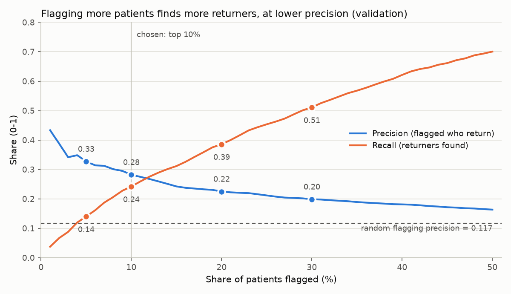
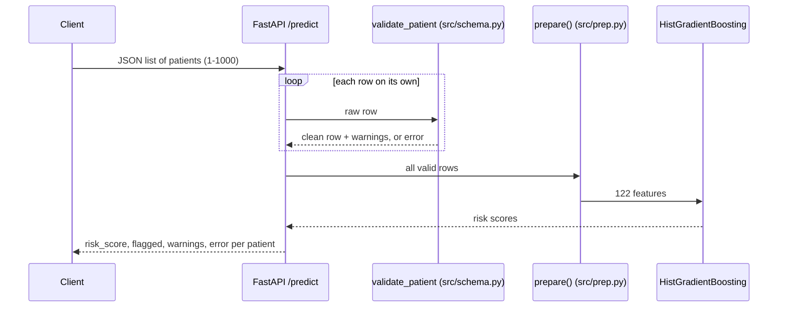
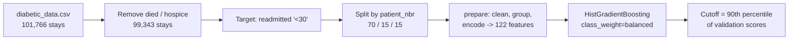

# Diabetes 30-Day Readmission Risk API

Ranks discharged diabetic patients by their risk of coming back to hospital within 30 days, so a
hospital can spend limited follow-up on the patients most likely to return.


> [!IMPORTANT]
> **`risk_score` is for ranking only. It is not a probability.** The model was trained with
> `class_weight="balanced"`, which inflates every score. A score of 0.49 does not mean a 49% chance.
> **This is a portfolio project and is not for clinical use.**

**At a glance:** on held-out test patients, flagging the top 10% finds **22% of the patients who
come back** (about 1 in 5). Among the flagged patients, **25% come back**, against 11% if you flagged
patients at random. That makes the model about **2.2x better than random**. It is a modest but real
signal: what this data records limits the score more than the choice of model does.

## Problem and goal

About 1 in 9 diabetic patients in this data is readmitted within 30 days. Follow-up calls and visits
are limited, so the useful question is **"who should we call first?"** rather than "will this
patient return?".

The service scores each discharged patient and **flags the top 10%**. The 10% is an assumed hospital
capacity, not a property of the model. A hospital that can follow up 20% of patients only needs a
different cutoff, taken from the same validation scores. No retraining is needed (see the trade-off
table below).

## Results

Validation is used to set the cutoff. The test set was scored **once**, with the cutoff fixed
beforehand. Sources: [eval/05_validation.txt](eval/05_validation.txt),
[eval/06_test.txt](eval/06_test.txt).

| Metric | Validation | Test | Never flag anyone (validation) |
|---|---|---|---|
| Patients (positives) | 14,911 (1,740) | 14,913 (1,658) | - |
| ROC-AUC | 0.670 | 0.671 | 0.5 |
| Average precision | 0.230 | 0.211 | 0.117 |
| Flagged | 10.0% | 9.9% | 0% |
| Recall (returners found) | 0.242 | 0.223 | 0 |
| Precision (flagged who return) | 0.282 | 0.250 | - |
| Lift over random flagging | 2.42x | 2.25x | - |
| Accuracy | - | - | **0.883** |
| Confusion matrix `[[TN, FP], [FN, TP]]` | `[[12100, 1071], [1319, 421]]` | `[[12144, 1111], [1288, 370]]` | `[[13171, 0], [1740, 0]]` |

The "never flag anyone" model scores 88% accuracy and is useless. This is why the project ranks
patients on average precision and lift instead of accuracy.

**Choosing how many to flag** (validation, cutoff re-set for each share):

| Flagged | Precision | Recall | Lift |
|---|---|---|---|
| top 5% | 0.33 | 0.14 | 2.8x |
| **top 10%** | **0.28** | **0.24** | **2.4x** |
| top 20% | 0.22 | 0.39 | 1.9x |
| top 30% | 0.20 | 0.51 | 1.7x |



Made by [eval/11_figure.py](eval/11_figure.py) from validation scores only.

## Quickstart

You do not need the dataset to run the API. The trained model ships in [model/](model/).

**Windows (PowerShell)**

```powershell
py -3.12 -m venv .venv
.venv\Scripts\python -m pip install -r requirements.txt
.venv\Scripts\uvicorn src.api:app --port 8000
```

**Linux / macOS**

```bash
python3.12 -m venv .venv
.venv/bin/python -m pip install -r requirements.txt
.venv/bin/uvicorn src.api:app --port 8000
```

Then, from the repo root (on Windows use `curl.exe`):

```bash
curl -X POST http://127.0.0.1:8000/predict -H "Content-Type: application/json" --data @examples/predict_request.json
```

Interactive docs: http://127.0.0.1:8000/docs

## How the API works



| Endpoint | Returns |
|---|---|
| `GET /health` | status, `model_version` (first 12 characters of the pipeline.pkl sha256), `cutoff`, library versions |
| `POST /predict` | one result per patient: `id`, `risk_score`, `flagged` (`risk_score >= cutoff`), `warnings`, `error` |

**Each patient gets one of three outcomes:**

| Outcome | `risk_score` | Meaning |
|---|---|---|
| Scored | number | Input was clean. |
| Scored with `warnings` | number | Input was usable, but a value was replaced on purpose, the way training did it. Example: an unseen `medical_specialty` becomes `Other`. Every warning is also logged. |
| `error` | `null` | The row was rejected and the message names each bad field. **Out of scope** is one kind of error: discharge codes 11, 13, 14, 19, 20, 21 (died or hospice) were removed before training, so these patients are not scored. Other rows in the same request are still scored. |

**Fields:** the 31 input fields use the column names and values of `diabetic_data.csv`.
- **8 optional fields:** `race`, `payer_code`, `medical_specialty`, `diag_1`, `diag_2`, `diag_3`,
  `max_glu_serum`, `A1Cresult`. You may send `"?"`, `null` or leave them out (Unknown / not tested).
- **23 required fields**, with exact values: for example `age` must be `"[60-70)"`, and `diabetesMed`
  must be `Yes` or `No` (so `yes` is rejected).
- `patient_nbr` / `encounter_id` are optional and only echoed back as `id`; the model never sees them.
- All rules: [src/schema.py](src/schema.py). Full example: [examples/predict_request.json](examples/predict_request.json)
  (synthetic patients).

**Real response** to [examples/predict_request.json](examples/predict_request.json), captured from a
local `uvicorn` run (patient 1003 is invalid on purpose):

```json
{
  "model_version": "4d16911b11d5",
  "cutoff": 0.6411267897454278,
  "note": "risk_score is for ranking only; it is not a probability",
  "n_scored": 2,
  "n_errors": 1,
  "results": [
    {"id": 1001, "risk_score": 0.4952840667495074, "flagged": false, "warnings": [], "error": null},
    {"id": 1002, "risk_score": 0.6569376945888847, "flagged": true,
     "warnings": ["medical_specialty: 'Astrology' not seen in training -> Other",
                  "diag_1: number 428 read as code '428'"],
     "error": null},
    {"id": 1003, "risk_score": null, "flagged": null, "warnings": [],
     "error": "age: Input should be '[0-10)', '[10-20)', '[20-30)', '[30-40)', '[40-50)', '[50-60)', '[60-70)', '[70-80)', '[80-90)' or '[90-100)'; diabetesMed: Input should be 'Yes' or 'No'; time_in_hospital: required field is missing"}
  ]
}
```

An out-of-scope patient (patient 1001 with `discharge_disposition_id: 11`) returns:
`"error": "discharge_disposition_id: Value error, code 11 means died or hospice: out of model scope (not in training)"`.

## How the model works



| Step | Decision | Why |
|---|---|---|
| Rows | Remove discharge codes 11, 13, 14, 19, 20, 21 (died or hospice) | These patients cannot be readmitted, so they would be easy false negatives. |
| Split | GroupShuffleSplit by `patient_nbr`: 70% train, 15% validation, 15% test | 46% of training stays belong to patients with more than one stay. Splitting by row would put the same patient on both sides. |
| Columns | Drop 16: `weight` (mostly missing) and 15 drugs where one value covers ≥ 99% of training rows | They carry almost no information. The list is learned from training rows only. |
| Diagnoses | ICD-9 codes -> 8 disease groups (Circulatory, Diabetes, Respiratory, ...) plus Other / Unknown | 912 distinct raw codes are too sparse; the groups follow standard ICD-9 ranges. |
| ID codes | Admission type, discharge and source -> a few groups (Home, Facility, Emergency, ...) | Many codes are rare or mean "unknown"; [IDS_mapping.csv](IDS_mapping.csv) defines them. |
| Rare categories | `medical_specialty` / `payer_code` values with < 500 training rows -> `Other` | Avoids one-hot columns that are almost empty. |
| Drugs | `Up` / `Down` -> `Changed` for 7 drugs (insulin kept as is) | Up and Down are rare for these drugs. |
| Visit counts | `log1p` on outpatient, emergency and inpatient visits | Long right tails. |
| Encoding | Age group -> midpoint, one-hot for categories, column order fixed to training | The API builds exactly the same 122 columns. |

**Final model:** `HistGradientBoostingClassifier(learning_rate=0.05, max_leaf_nodes=31,
min_samples_leaf=50, l2_regularization=10, max_iter=200, early_stopping=True, class_weight="balanced",
random_state=42)`. Early stopping ended at 89 iterations. The settings come from a 12-trial random
search with 5-fold GroupKFold cross-validation on training data (notebook cell 39);
[src/train.py](src/train.py) retrains with them.

**Cutoff:** the 90th percentile of validation scores (0.6411), so 10% of validation patients are flagged.

**Why three models tied:** before tuning, on validation, Logistic Regression, Random Forest and
Gradient Boosting reached average precision 0.219 / 0.224 / 0.226 and ROC-AUC 0.664 / 0.672 / 0.667
(notebook cell 37). When very different models land within 0.01, the limit is the information in the
data (one hospital stay, no labs over time, no notes), not the algorithm.

## Data

- **Source:** [UCI ML Repository: Diabetes 130-US Hospitals for Years 1999-2008](https://archive.ics.uci.edu/dataset/296/diabetes+130-us+hospitals+for+years+1999-2008),
  DOI [10.24432/C5230J](https://doi.org/10.24432/C5230J), license **CC BY 4.0**.
- **Coverage:** 101,766 hospital stays from 1999-2008 at 130 US hospitals. The data includes
  **race, gender and age group**.
- **Citation:** Strack B, DeShazo JP, Gennings C, Olmo JL, Ventura S, Cios KJ, Clore JN.
  *Impact of HbA1c Measurement on Hospital Readmission Rates: Analysis of 70,000 Clinical Database
  Patient Records.* BioMed Research International, 2014, Article ID 781670.
  DOI [10.1155/2014/781670](https://doi.org/10.1155/2014/781670).

**Get the data:** download the zip from the UCI page, unzip it, and put `diabetic_data.csv` in the
repo root, next to `README.md`. `IDS_mapping.csv` is already in the repo. The CSV is not committed
(see [.gitignore](.gitignore)). It is needed to retrain, run `eval/` or run the data-dependent tests,
but not to run the API.

## Project structure

```
.
├── CLAUDE.md                 project rules for AI-assisted work
├── Diabetes.ipynb            original exploration notebook (read-only source)
├── IDS_mapping.csv           meaning of the admission / discharge / source codes
├── LICENSE                   MIT (code)
├── README.md
├── requirements.txt          pinned runtime + test dependencies
├── requirements-dev.txt      + matplotlib, only for the README figure
├── docs/flag_tradeoff.png    README figure
├── examples/predict_request.json  3 synthetic patients: clean, warnings, error
├── model/
│   ├── pipeline.pkl          trained model + cutoff + columns + training config
│   └── schema_values.json    allowed input values (training split + IDS_mapping)
├── src/
│   ├── api.py                FastAPI app: /health, /predict
│   ├── build_schema_values.py  writes model/schema_values.json
│   ├── data.py               load, remove died/hospice, target, patient split
│   ├── prep.py               prepare(): raw rows -> 122 features
│   ├── schema.py             pydantic validation of one patient
│   ├── scoring.py            per-row validation + scoring + warnings
│   └── train.py              trains and saves model/pipeline.pkl
├── eval/                     re-evaluation scripts and their outputs (see below)
└── tests/                    pytest suite (see below)
```

Links: [CLAUDE.md](CLAUDE.md) · [Diabetes.ipynb](Diabetes.ipynb) · [LICENSE](LICENSE) ·
[requirements.txt](requirements.txt) · [requirements-dev.txt](requirements-dev.txt) ·
[model/pipeline.pkl](model/pipeline.pkl) · [model/schema_values.json](model/schema_values.json) ·
[src/api.py](src/api.py) · [src/build_schema_values.py](src/build_schema_values.py) · [src/data.py](src/data.py) ·
[src/prep.py](src/prep.py) · [src/schema.py](src/schema.py) · [src/scoring.py](src/scoring.py) ·
[src/train.py](src/train.py) · [eval/](eval/) · [tests/](tests/)

## Testing and evaluation

```bash
.venv/bin/python -m pytest -q        # Windows: .venv\Scripts\python -m pytest -q
```

154 tests cover:
- **Robustness:** 140 input cases (unseen values, `"?"` / `null` / missing in every field,
  odd diagnosis codes, out-of-range counts, wrong types). Each case has a required outcome: an error
  that names the field, a logged warning, or a clean score for valid input. None may give a wrong
  score without a warning ([tests/cases.py](tests/cases.py),
  [tests/test_scoring.py](tests/test_scoring.py)).
- **Batches:** one bad row does not change the others; one row scores the same alone or in a batch;
  the input is never changed.
- **No drift:** all 14,911 validation rows give bit-identical scores and features to the evaluated
  model, and `pipeline.pkl` matches its recorded sha256 ([tests/test_clean_scores.py](tests/test_clean_scores.py)).
- **API:** `/health`, `/predict`, bad bodies, and that the word "probability" appears only in the
  "not a probability" note ([tests/test_api.py](tests/test_api.py)).
- **README:** every relative link exists and no local absolute path appears ([tests/test_readme_links.py](tests/test_readme_links.py)).

Without `diabetic_data.csv`, the 5 data-dependent tests are **skipped** with a message telling you to
download it. All other tests run.

| Script | Checks | Output |
|---|---|---|
| [eval/03_data.py](eval/03_data.py) | row counts, split sizes, no patient overlap, `prepare()` equals the notebook | [03_data.txt](eval/03_data.txt) |
| [src/train.py](src/train.py) | trains, saves, reloads and re-scores | [04_train.txt](eval/04_train.txt) |
| [eval/05_validation.py](eval/05_validation.py) | validation metrics vs expected values, baseline | [05_validation.txt](eval/05_validation.txt) |
| [eval/06_test.py](eval/06_test.py) | the single test-set run | [06_test.txt](eval/06_test.txt) |
| [eval/07_robustness.py](eval/07_robustness.py) | bad inputs against raw `prepare()` (before the API checks existed) | [07_robustness.txt](eval/07_robustness.txt) |
| [eval/08_leakage.py](eval/08_leakage.py) | no label or ID features, training-only config, test usage in the notebook | [08_leakage.txt](eval/08_leakage.txt) |
| [eval/09_fairness.py](eval/09_fairness.py) | flag rate, recall, precision, lift by race, gender, age (validation) | [09_fairness.txt](eval/09_fairness.txt) |
| [eval/10_reference.py](eval/10_reference.py) | freezes the reference scores and model hash | [10_reference.txt](eval/10_reference.txt) |
| [eval/11_figure.py](eval/11_figure.py) | README figure | [11_figure.txt](eval/11_figure.txt) |

## Fairness and limitations

Measured on validation only ([eval/09_fairness.txt](eval/09_fairness.txt)):

- **Gender is balanced:** recall is 0.243 for women and 0.240 for men.
- **Unknown race (`?`, 249 patients):** only **2.9%** are flagged (overall 10%), and recall is 0.05.
  The model almost never flags these patients.
- **Age 90+ (293 patients):** lift **1.0**, so ranking is no better than random in this group.
- **Small groups** (Asian, Other race, ages 0-30; under 200 patients each) are too small to judge.
  The Hispanic lift of 3.5 rests on only 35 positives.

**Other limitations**
- **Validation is slightly optimistic:** it was used both to compare models and to set the cutoff.
  The test numbers are the honest ones (average precision 0.211 vs 0.230).
- **Early stopping** holds out a random 10% of training rows that is not split by patient, so the same
  patient can appear on both sides ([eval/08_leakage.txt](eval/08_leakage.txt)). This affects only when
  training stops, not the test results.
- **Old data:** the data covers 1999-2008, with ICD-9 codes (US hospitals switched to ICD-10 in 2015).
  Care and coding have changed since.

**Do not use this model** to decide anyone's care, to deny or ration services, to compare hospitals
or doctors, or as a probability of readmission. Use it only to explore ranking ideas on this public
dataset.

## Design decisions and lessons

- **Split by patient, not by row.** Repeat patients would otherwise leak between train and test and
  inflate every score.
- **Accuracy is misleading.** Flagging nobody gives 88% accuracy, so the project uses average
  precision, recall at a fixed share, and lift.
- **A ranking score, not a probability.** Balanced class weights push scores up. Only the order is
  meaningful, so the API says `risk_score` and repeats the warning in every response.
- **Validation scores run slightly high** because validation also picked the model and the cutoff.
  The test set was used once and never tuned on.
- **Reject or warn, never guess silently.** Bad input gives an error, or a warning when the fallback
  matches what training did.

## Roadmap (planned, not built)

- [ ] A `caution` field for groups where the model ranks poorly (unknown race, age 90+)
- [ ] A cap or rejection for counts far above the training range (now: warning only)
- [ ] Authentication and rate limiting
- [ ] Persistent, structured logging (now: console only)
- [ ] Dockerfile
- [ ] Calibrated scores for display (ranking would stay on the raw score)
- [ ] An ablation without `race`, to measure its effect on accuracy and fairness

## License and disclaimer

- **Code:** [MIT](LICENSE).
- **Data:** CC BY 4.0, from the UCI ML Repository (see [Data](#data) for the required citation).
- **Pickle files:** `model/pipeline.pkl` is a joblib/pickle file. Loading a pickle can run arbitrary
  code, so only load pickles from sources you trust.
- **Disclaimer:** for education and portfolio use only. Not a medical device, not validated for
  clinical use, and no warranty of any kind.
